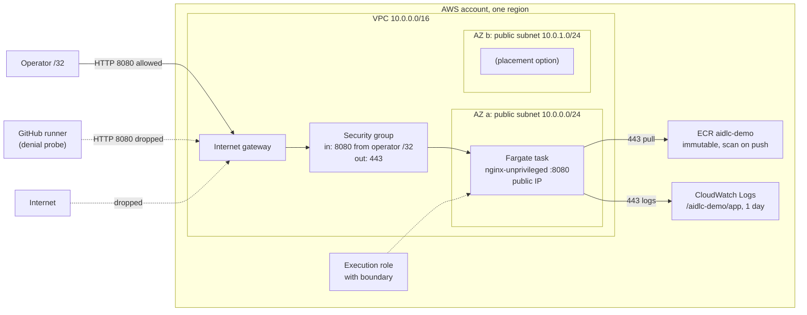
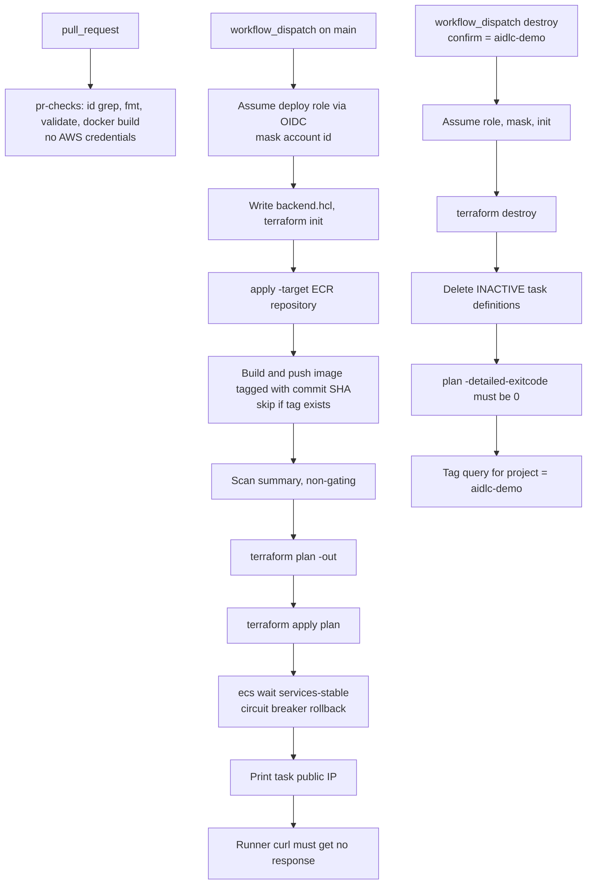

# Deployment Architecture: reference-deployment

## Runtime Topology

### Text Alternative

- The operator, at a single `/32`, sends HTTP on port 8080 to the task's public IP. It passes through the internet gateway, and the security group allows it.
- Everyone else, including the GitHub runner, is dropped by the security group. The runner checks this on every deploy.
- The Fargate task runs in one of two public subnets, in two AZs, inside VPC `10.0.0.0/16`.
- The task's only outbound connections go over 443 through the internet gateway, to pull from ECR and write to CloudWatch Logs. There is no NAT gateway, no VPC endpoints and no load balancer.
- The execution role, which carries the permissions boundary, lets ECS pull the image and write logs for the task.

## Delivery Pipeline

### Text Alternative

1. **Pull request.** Runs the 12-digit id grep, `terraform fmt`, `init` and `validate`, and `docker build`. It uses no AWS credentials.
2. **Deploy, a manual trigger on main.** It:
   1. assumes the role through OIDC and masks the account id;
   2. writes `backend.hcl` and runs `init`;
   3. applies the ECR repository on its own;
   4. builds and pushes the image tagged with the commit SHA, skipping this if the tag already exists;
   5. prints the scan summary;
   6. plans, then applies the saved plan;
   7. waits for the service to become stable, with circuit-breaker rollback;
   8. prints the task's public IP;
   9. runs the runner denial check.
3. **Destroy, a manual trigger with confirmation.** It:
   1. assumes the role, masks the account id and runs `init`;
   2. runs `terraform destroy`;
   3. deletes the INACTIVE task definitions;
   4. requires an empty plan;
   5. runs the tag query.

## Pre-existing, Hand-made (Not Managed Here)

| Resource | Used by | Removed by |
|---|---|---|
| State bucket `<PROJECT>-tfstate-<ACCOUNT_ID>` | Terraform backend | Hand, per `docs/prerequisites.md` Removal |
| GitHub OIDC provider | Deploy and destroy workflows | Hand |
| Deploy role and policy | Deploy and destroy workflows | Hand |
| Permissions boundary `aidlc-demo-task-boundary` | Attached to the execution role | Hand |
| Repository variables `AWS_DEPLOY_ROLE_ARN`, `AWS_REGION` | Workflows | Hand |
| Repository secret `OPERATOR_CIDR` (**new, to be added by the operator**) | Deploy and destroy workflows | Hand |

## Operator Sequence (for the runbook)

1. Add the repository secret `OPERATOR_CIDR`, set to `<your-ip>/32`.
2. Run **Deploy**. Read `Service address: http://<ip>:8080/` from the log.
3. Run `curl http://<ip>:8080/` from the operator machine and expect the fixed response.
4. When finished, run **Destroy** with `confirm = aidlc-demo`. The job checks that the plan is empty and prints the tag query.
5. Remove the hand-made resources per `docs/prerequisites.md` Removal, and record the verification in `audit.md`.
