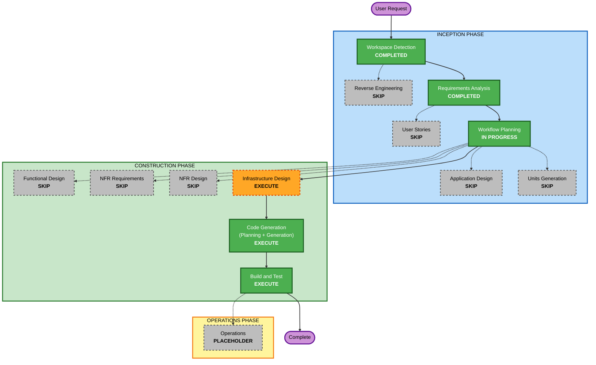

# Execution Plan

Inputs: `docs/vision.md`, `aidlc-docs/inception/requirements/requirements.md` (approved 2026-11-18T06:36:50Z), and the answered `requirement-verification-questions.md`.

## Detailed Analysis Summary

### Change Impact Assessment
- **User-facing changes**: Yes, minimal. One HTTP endpoint returning fixed text on port 8080, reachable from one operator address.
- **Structural changes**: Yes, all of it is new.
  - A VPC with two public subnets, an internet gateway and routing, plus one security group.
  - An ECR repository.
  - An ECS cluster, a task definition and a service, with a log group and one IAM execution role.
  - Three GitHub Actions workflows: pull-request checks, deploy, and destroy.
- **Data model changes**: No. There is no data store.
- **API changes**: No. There is no API contract beyond a fixed `GET` response.
- **NFR impact**: Yes. All of it was settled in requirements:
  - security: ingress `/32`, no identifiers in tracked files, masking in logs, pinning, non-root container, the boundary on the role;
  - cost: no ALB, NAT gateway or endpoints;
  - reproducibility.

### Risk Assessment
- **Risk Level**: Low. The account is isolated, the infrastructure is short-lived, and nothing depends on it.
- **Rollback Complexity**: Easy. The destroy workflow removes it, and it is verified by plan and by tag query.
- **Testing Complexity**: Simple:
  - static checks (`fmt`, `validate`, `docker build`);
  - one real deploy, then `curl` from the operator address;
  - one negative check, that another address is refused;
  - destroy verification.
- **Main live risks**:
  - The deploy role's hand-scoped policy may lack an action this design needs, which shows up as `AccessDenied` on the first apply. The fix belongs in the hand-made policy, outside this repository.
  - The image pull fails if the public IP is not assigned (FR-4.3).

### Units
One unit, **`reference-deployment`**. It contains:
- the Terraform root module;
- the `Dockerfile` and static content;
- the three workflows;
- the deploy runbook.

These cannot be deployed independently. The image needs the ECR repository, and the workflows drive the Terraform. That is why Units Generation is skipped.

## Workflow Visualization



### Text Alternative

```
INCEPTION
- Workspace Detection ...... COMPLETED
- Reverse Engineering ...... SKIP (greenfield)
- Requirements Analysis .... COMPLETED (approved)
- User Stories ............. SKIP
- Workflow Planning ........ IN PROGRESS
- Application Design ....... SKIP
- Units Generation ......... SKIP

CONSTRUCTION (unit: reference-deployment)
- Functional Design ........ SKIP
- NFR Requirements ......... SKIP
- NFR Design ............... SKIP
- Infrastructure Design .... EXECUTE
- Code Generation .......... EXECUTE (Part 1 plan, Part 2 generate)
- Build and Test ........... EXECUTE

OPERATIONS
- Operations ............... PLACEHOLDER
```

## Phases to Execute

### INCEPTION PHASE
- [x] Workspace Detection (COMPLETED)
- [x] Reverse Engineering (SKIPPED). Greenfield, so there is no code to analyse.
- [x] Requirements Analysis (COMPLETED, approved)
- [x] User Stories (SKIPPED)
  - **Rationale**: There is one persona (the presenter) and no business logic or user journeys. Vision §5 says it should be skipped, and you didn't choose "Add User Stories" at the requirements gate.
- [x] Execution Plan (IN PROGRESS)
- [ ] Application Design - SKIP
  - **Rationale**: There is one component, with no methods, business rules or service layer. The "application" is a static file served by nginx.
- [ ] Units Generation - SKIP
  - **Rationale**: There is a single unit (see Units above). The parts can't be deployed independently, so there is nothing to break down.

### CONSTRUCTION PHASE
- [ ] Functional Design - SKIP
  - **Rationale**: There are no data models, business logic or business rules. FR-1 fully specifies the behaviour, a constant response.
- [ ] NFR Requirements - SKIP
  - **Rationale**: Every NFR is already pinned in requirements.md §2 (NFR-1 to NFR-10), and the tech stack is fixed (Q6, Q9, FR-6.1). The security, resiliency and property-based testing extensions are all disabled. Running this stage would repeat approved decisions.
- [ ] NFR Design - SKIP
  - **Rationale**: NFR Requirements is skipped. The NFR patterns are simple and concrete (variable validation, `::add-mask::`, digest and SHA pinning, the boundary), and Infrastructure Design will put them in place.
- [ ] Infrastructure Design - EXECUTE
  - **Rationale**: The system is mainly infrastructure. This stage maps the requirements onto concrete resources, files and workflows:
    - Terraform resources and file layout, variables and outputs;
    - subnet and AZ choices, and security-group rules;
    - the IAM role and boundary wiring;
    - the job and step design of each workflow, and the SHA pins;
    - the ECR bootstrap sequence;
    - the destroy-verification design.
  - It also holds the explicit **NFR-10 review pass** the vision requires, of the ingress rule, the IAM role and the base image. The `builder-security` exposure policy will be applied here, because this stage designs a network-reachable service.
- [ ] Code Generation - EXECUTE (ALWAYS)
  - **Rationale**: Write the Terraform, the Dockerfile and content, the workflows, the runbook, and the updates to the prerequisites doc. Part 1 is a checklist plan for your approval, and Part 2 generates the files.
- [ ] Build and Test - EXECUTE (ALWAYS)
  - **Rationale**:
    - Run locally: `terraform fmt`, `init -backend=false`, `validate`, and `docker build`, plus a grep for account ids or ARNs in tracked files.
    - Produce the instructions for the live deploy and teardown, and the success-criteria checks (vision §4).

### OPERATIONS PHASE
- [ ] Operations - PLACEHOLDER. It does nothing in v1. Teardown is covered by FR-9 and the Build and Test instructions.

## Estimated Timeline
- **Stages remaining**: 4 (finish Workflow Planning, then Infrastructure Design, Code Generation and Build and Test).
- **Gates remaining**: 5. One each for Workflow Planning, Infrastructure Design, the Code Generation plan, Code Generation, and Build and Test.
- **Estimated duration**: about 2 to 3 hours of agent and review time. The first live deploy is extra, and depends on how much the deploy-role policy needs adjusting.

## Success Criteria
- **Primary goal**: A fixed HTTP response from a Fargate task deployed by GitHub Actions, with every AI-DLC stage approved and recorded in `audit.md`.
- **Key deliverables**:
  - `infra/`: the Terraform root module, the lock file and `backend.hcl.example`;
  - `app/`: the Dockerfile and static content;
  - `.github/workflows/`: pull-request checks, deploy and destroy;
  - a deploy runbook;
  - the `docs/prerequisites.md` update.
- **Quality gates**:
  - `terraform fmt -check` and `validate` pass.
  - `docker build` succeeds.
  - No account id, bucket name, role ARN or IP in tracked files, checked by grep.
  - Every action is pinned to a SHA, and the base image to a digest.
  - Ingress validation rejects anything other than a single `/32`.
  - The live check: `curl` from the operator address succeeds, the destroy plan shows no changes, and the tag query finds only the hand-made resources.
